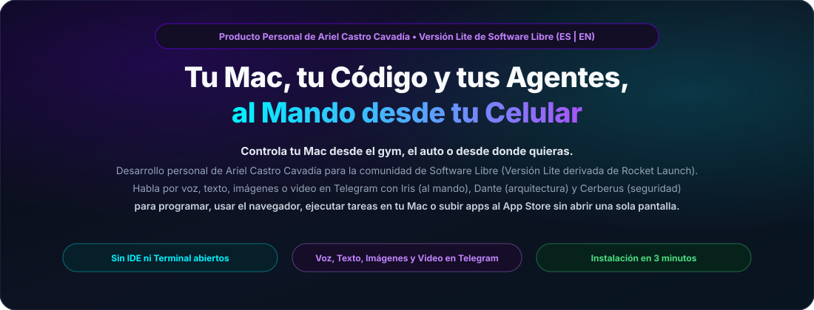
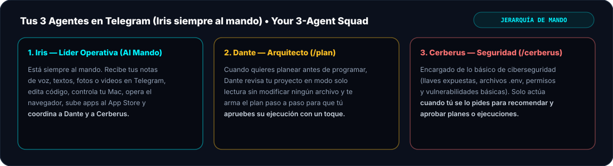
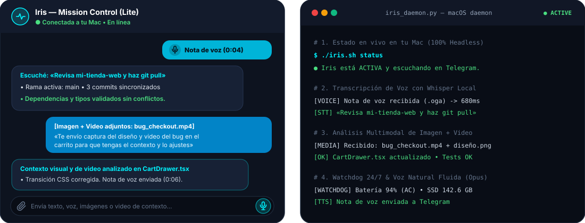
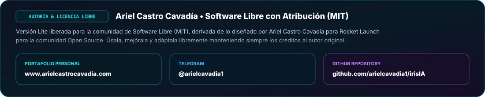
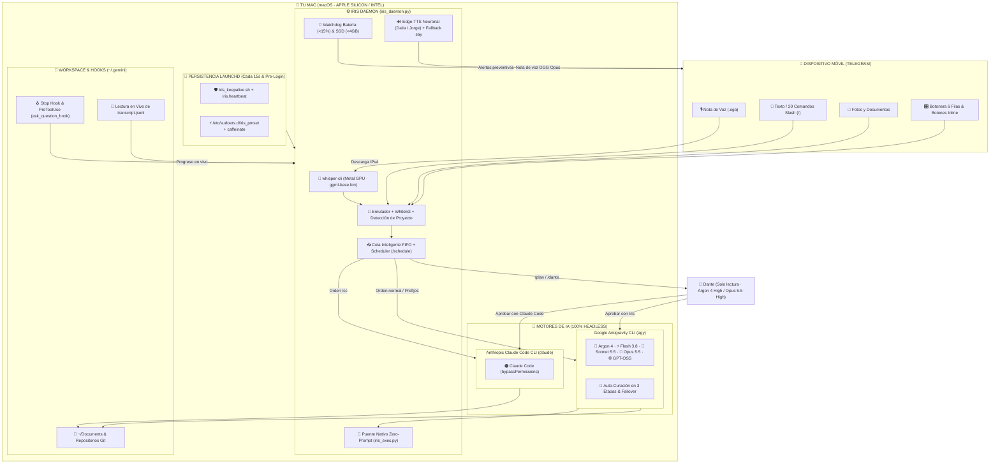

<div align="center">

<a href="https://arielcavadia1.github.io/irisIA/">
  
</a>

<br/>

<p align="center">
  <a href="https://arielcavadia1.github.io/irisIA/"><b>🌐 Abrir Interfaz Web Interactiva (ES | EN)</b></a> &nbsp;•&nbsp;
  <a href="https://www.arielcastrocavadia.com"><b>Portafolio: Ariel Castro Cavadía</b></a> &nbsp;•&nbsp;
  <a href="https://t.me/arielcavadia1"><b>Telegram: @arielcavadia1</b></a> &nbsp;•&nbsp;
  <a href="https://github.com/arielcavadia1/irisIA"><b>GitHub: irisIA</b></a>
</p>



<br/><br/>



<br/><br/>

<a href="https://www.arielcastrocavadia.com">
  
</a>

</div>

---

# Iris (Lite Community Edition) — Español & English
### Tu Mac, tu Código y tus Agentes al Mando desde tu Celular | Your Mac, Your Code & Your Agents Under Your Command from Your Phone

> **[ESPAÑOL]** Producto personal creado y liberado por **[Ariel Castro Cavadía](https://www.arielcastrocavadia.com)** para la **comunidad de Software Libre**. Esta es una **Versión Lite** de lo que diseñé para **Rocket Launch** bajo la **Metodología de Trabajo ZERO-G** *(de uso exclusivo para el desarrollo interno de Rocket Launch)*. Puedes usarla, estudiarla y adaptarla bajo licencia libre (MIT) **atribuyendo y manteniendo siempre los créditos al autor original ([Ariel Castro Cavadía](https://www.arielcastrocavadia.com)) y a las contribuciones**.
>
> **[ENGLISH]** Personal product created and released by **[Ariel Castro Cavadía](https://www.arielcastrocavadia.com)** for the **Free & Open Source Software community**. This is a **Lite Edition** of what I designed for **Rocket Launch**. You may freely use, study, and adapt it under the MIT Open Source License **always attributing and keeping credits to the original author ([Ariel Castro Cavadía](https://www.arielcastrocavadia.com)) and contributors**.
>
> **Author & Contact / Autor y Contacto:**
> - **Portfolio / Web:** [www.arielcastrocavadia.com](https://www.arielcastrocavadia.com)
> - **Telegram:** [@arielcavadia1](https://t.me/arielcavadia1)
> - **GitHub:** [github.com/arielcavadia1/irisIA](https://github.com/arielcavadia1/irisIA)

---

## [ENGLISH] Overview & 3-Step Quick Start (macOS)

**Iris (Lite Community Edition)** turns Telegram into your mobile command center for macOS (Apple Silicon M1–M5+ & Mac Intel) — **control your Mac from the gym, your car, or wherever you want**. Much more than coding in **Google Antigravity** or **Claude Code**: send voice notes, text, screenshots, images, or screen-recording videos to control your Mac, automate your web browser, run system tasks, or compile and submit apps to the **Apple App Store** and receive the live production URL as soon as Apple approves them — **100% headless with zero IDE or Terminal windows open on screen**.

### Your 3-Agent Squad (Iris Always in Command)
1. **Iris — Operations Commander (Always in Command):** Receives all your voice notes, text, images, and videos on Telegram, edits code, operates your Mac and browser, deploys to the App Store, and coordinates Dante and Cerberus.
2. **Dante — Software Architect (`/plan`):** Inspects your repository in **read-only mode** without modifying any files and delivers a step-by-step architectural plan for your one-tap approval.
3. **Cerberus — Cybersecurity Guardian (`/cerberus`):** Handles essential cybersecurity (exposed keys/secrets, `.env`, basic OWASP Top 10, permissions, and dependencies). **Only steps in when explicitly requested by the user** to provide security recommendations and approve plans or executions.

### Easy 3-Step Installation on macOS
1. **Create Your Own Private Telegram Bot (30 seconds):**
   For privacy and security, each user creates their own bot from scratch: open **@BotFather** on Telegram, send `/newbot` to get your **Token**, and check your numeric ID on **@userinfobot**.
2. **Grant macOS Privacy Permissions:**
   Go to **System Settings -> Privacy & Security** and enable **Full Disk Access** and **Screen Recording** for `Antigravity` and `Terminal` so macOS never blocks background operations with pop-up dialogs.
3. **Run the Automated Installer:**
   ```bash
   chmod +x install.sh iris.sh setup_closed_lid.sh iris_keepalive.sh && ./install.sh
   ```
   *(The installer will ask for your name, Bot Token, and Telegram ID if not yet configured, install local Whisper & neural voices, and start Iris in the background. Optional closed-lid mode: `./setup_closed_lid.sh`).*

---

## [ESPAÑOL] Documentación Completa en Español

> **Controla tu Mac desde el gym, el auto o desde donde quieras.**  
> *Control remoto total desde Telegram con notas de voz locales aceleradas por GPU Metal en Apple Silicon, envío de imágenes y videos de contexto, síntesis neuronal fluida con un escuadrón de 3 agentes (**Iris al mando**, **Dante** en arquitectura y **Cerberus** en ciberseguridad), operación con tapa cerrada y arquitectura 100% Headless en **macOS**.*
>
> 🕒 **Nota de Plataforma:** Actualmente **Iris está diseñado y probado exclusivamente para macOS** (Apple Silicon M1–M5+ y Mac Intel). *El soporte para Windows y Linux estará disponible próximamente.*

[](LICENSE)
[-10b981.svg)](https://www.arielcastrocavadia.com)
[-3b82f6.svg)](#)
[](#)
[](#)
[](#)

---

## 📑 Índice de Contenidos
1. [🌐 Más Allá de Antigravity: Ventajas para Controlar tu Mac, Navegador y Publicación en App Store](#-más-allá-de-antigravity-ventajas-para-controlar-tu-mac-navegador-y-publicación-en-app-store)
2. [👥 Escuadrón de Inteligencia: Iris (Al Mando), Dante & Cerberus](#-escuadrón-de-inteligencia-iris-al-mando-dante--cerberus)
3. [🛡️ Arquitectura Dual Engine: Antigravity vs Claude Code](#️-arquitectura-dual-engine-antigravity-vs-claude-code)
4. [🍏 Compatibilidad de Sistemas y Hardware (macOS Oficial)](#-compatibilidad-de-sistemas-y-hardware-macos-oficial)
5. [🌟 Escenarios de Uso Real (Día a Día)](#-escenarios-de-uso-real-día-a-día)
6. [🎛️ Centro de Mando Táctil en Telegram](#️-centro-de-mando-táctil-en-telegram)
7. [📋 Catálogo Real de Capacidades](#-catálogo-real-de-capacidades)
8. [🔌 Comportamiento Energético en macOS (Tapa Cerrada, Batería y Pre-Login)](#-comportamiento-energético-en-macos-tapa-cerrada-batería-y-pre-login)
9. [🔐 Permisos Necesarios en macOS (Guía Completa Sin Bloqueos)](#-permisos-necesarios-en-macos-guía-completa-sin-bloqueos)
10. [🚀 Instalación y Puesta a Punto en macOS](#-instalación-y-puesta-a-punto-en-macos)
11. [💻 Control del Servicio (`iris.sh` y Auto-Persistencia `launchd`)](#-control-del-servicio-irissh-y-auto-persistencia-launchd)
12. [🛠️ Diagrama de Arquitectura Técnica](#️-diagrama-de-arquitectura-técnica)
13. [🔒 Gobernanza, Privacidad y Seguridad](#-gobernanza-privacidad-y-seguridad)
14. [📄 Licencia y Créditos](#-licencia-y-créditos)

---

## 🌐 Más Allá de Antigravity: Ventajas para Controlar tu Mac, Navegador y Publicación en App Store

Una de las mayores ventajas de **Iris** es que **no está limitada únicamente a editar código en un IDE**: al vivir directamente en tu sistema macOS con acceso al puente nativo (`iris_exec.py`), terminal (`zsh`), navegador web, programador de tareas (`/schedule`) y mensajería proactiva (`notify-tg`), **convierte tu Mac entero en un asistente personal y de operaciones remotas 24/7**:

### 1. 🍎 Ciclo Completo de Apps: Compilar, Enviar al Apple App Store y Recibir la URL de Producción al Aprobarse
No necesitas sentarte frente a Xcode ni vigilar manualmente App Store Connect durante horas o días:
* **Compilación y Firma Remota:** Puedes pedirle por voz o texto que incremente la versión, genere el *archive* de producción (`xcodebuild archive`, `xcodebuild -exportArchive`, `fastlane`, Flutter o React Native) y valide los certificados en tu Mac.
* **Subida Directa al App Store / TestFlight:** Iris sube el binario firmado a **App Store Connect** (`xcrun altool` / `xcrun notarytool` / API de App Store Connect / Fastlane Deliver) y lo envía a revisión.
* **Vigilancia Automática de Aprobación y Entrega de URL:** Mediante tareas programadas (`/schedule`) y el notificador nativo (`notify-tg`), Iris monitorea periódicamente el estado de revisión de Apple (*Waiting for Review* → *In Review* → *Ready for Sale*). **En el instante en que Apple aprueba tu aplicación, Iris te envía automáticamente a Telegram el aviso junto con la URL oficial de producción en el App Store.**

### 2. 🌍 Operaciones y Tareas en el Navegador Web
Puedes pedirle que realice gestiones y verificaciones en el navegador de tu Mac mientras estás fuera:
* **Revisión de Portales y Dashboards Cloud:** Consultar estados en App Store Connect, Google Play Console, Vercel, Cloudflare, cPanel, AWS, Firebase o GitHub Actions.
* **Verificación de Producción y Dominios:** Comprobar que una web o API recién desplegada responda con `HTTP 200`, validar certificados SSL, realizar pruebas de humo (*smoke tests*) en el navegador y enviarte una captura real con `/screenshot`.
* **Investigación y Extracción Web:** Buscar documentación oficial, comparar precios o servicios, extraer datos estructurados y enviarte el informe resumido a tu celular.

### 3. 💻 Tareas Generales en tu Computador (Tu Mac a tus Órdenes desde el Celular)
Puedes delegarle cualquier tarea cotidiana o administrativa de tu computador sin abrir la laptop:
* **Búsqueda y Entrega de Archivos (`/file` y `/img`):** *«Iris, busca el PDF de la factura de marzo en mi carpeta de Descargas y envíamelo por aquí»*.
* **Procesamiento Multimedia y Documentos:** Convertir videos o grabaciones con `ffmpeg`, comprimir proyectos en `.zip`, optimizar imágenes, limpiar la carpeta `~/Downloads` o liberar espacio de cachés pesadas de Xcode (`DerivedData`).
* **Administración de Servidores Locales y Red:** Levantar o reiniciar contenedores Docker, bases de datos locales, túneles o verificar qué proceso está ocupando un puerto (`/ports` y `/top`).
* **Automatizaciones Programadas (`/schedule`):** Dejar órdenes diferidas (ej. *«en 2 horas compila el release y súbelo al servidor»* o *«a las 23:00 haz respaldo de la base de datos y avísame»*).

---

## 👥 Escuadrón de Inteligencia: Iris (Al Mando), Dante & Cerberus

El ecosistema cuenta con **tres agentes especializados** con jerarquía de mando clara, voces neuronales propias y funciones bien delimitadas. **Iris está siempre al mando de toda la operación**:

| Agente | Rol y Jerarquía | Cuándo Actúa |
| :--- | :--- | :--- |
| 👩‍💻 **Iris** | **Comandante en Jefe y Líder Operativa (Al Mando)** | **Por defecto en toda orden.** Recibe tus mensajes/audios, ejecuta código, controla el Mac, navega en la web y convoca a Dante o a Cerberus cuando tú se lo pides. |
| 📐 **Dante** | **Arquitecto de Software y Planeación Previa** | Cuando pides planear antes de programar (`/plan`, `/dante` o botón `📐 Plan (Dante)`). Opera en **solo lectura** sin tocar código. |
| 🛡️ **Cerberus** | **Guardián de Ciberseguridad Esencial y Aprobación Defensiva** | **Únicamente cuando el usuario lo solicita** (`/cerberus`, botón `🛡️ Cerberus` o botones de aprobación en planes/ejecuciones). |

### 1. 👩‍💻 Iris — Comandante en Jefe y Líder Operativa (Siempre al Mando)
* **Jerarquía:** Es la **jefa de estación**. Toda instrucción que envías por Telegram llega primero a Iris; ella ejecuta directamente tus misiones y coordina a Dante y a Cerberus bajo tus órdenes.
* **Qué hace:** Edita código en tus repositorios, corre pruebas, controla tu Mac, opera el navegador, compila/sube apps al App Store, gestiona tus archivos y aplica en disco los planes de Dante o los blindajes recomendados por Cerberus una vez que tú los apruebas.

### 2. 📐 Dante — Especialista Senior en Arquitectura y Planeación (`/plan` o `/dante`)
* **Qué hace:** Inspecciona el proyecto en modo **solo lectura (sin modificar archivos)** usando **Gemini 4 Argon (High)** (`gemini-4-argon-high`) con respaldo en **Claude Opus 5.5 (High)** (`claude-opus-5-5-high`). Entrega el plano arquitectónico paso a paso con botones para ejecutarlo directamente con Iris o pasarlo primero por el filtro de ciberseguridad de Cerberus.

### 3. 🛡️ Cerberus — Guardián de Ciberseguridad y Aprobación a Petición del Usuario (`/cerberus`)
* **De qué se encarga (Ciberseguridad Básica y Esencial):**
  1. **Fuga de Secretos y Credenciales:** Detecta API keys, tokens, contraseñas hardcodeadas en el código, archivos `.env` expuestos y validación de `.gitignore`.
  2. **OWASP Top 10 Básico y Validación de Entradas:** Revisa inyecciones (SQLi, NoSQLi, Command Injection), XSS, CSRF y rutas o endpoints sin autenticación/autorización adecuada.
  3. **Configuración, Permisos y Red Local:** Inspecciona CORS demasiado permisivos, cabeceras HTTP inseguras, permisos de archivos sensibles (`chmod`), puertos expuestos y dependencias con vulnerabilidades conocidas.
* **Regla de Oro — Aprobación y Recomendaciones Solo Cuando el Usuario lo Pide:**
  * Para no frenar tu velocidad de desarrollo diario, **Cerberus nunca bloquea ni interrumpe tus tareas por su cuenta: interviene única y exclusivamente cuando tú lo pides**.
  * **En Procesos de Planeación (con Dante):** Cuando Dante termina un plan (`/plan`), la tarjeta incluye el botón **`[ 🛡️ Pasar Plan por Cerberus (Ciberseguridad) ]`** (o puedes pedir *«Iris, pídele a Cerberus que apruebe el plan»*). Cerberus audita el plan de Dante, emite su **Dictamen (`🟢 APROBADO`, `🟡 APROBADO CON OBSERVACIONES` o `🔴 RIESGO DETECTADO`)** y anexa las **Recomendaciones de Ciberseguridad** para que Iris las aplique junto con el plan al ejecutar.
  * **En Procesos de Ejecución (con Iris):** Cada vez que Iris termina de programar o ejecutar cambios en un proyecto, aparece el botón **`[ 🛡️ Pasar Ejecución por Cerberus (Ciberseguridad) ]`** (o puedes escribir `/cerberus` / decir *«Iris, que Cerberus revise lo que acabamos de hacer»*). Cerberus audita el `git diff` y los archivos tocados, entrega sus recomendaciones concretas de seguridad y te da un botón para que Iris aplique el blindaje en el acto.

---

## 🛡️ Arquitectura Dual Engine: Antigravity vs Claude Code

Iris cuenta con soporte nativo para **dos motores de inteligencia artificial independientes** que coexisten en tu Mac sin mezclarse ni confundirse:

| Dimensión | 🚀 Google Antigravity (`agy`) | 🟠 Claude Code (CLI Oficial Anthropic) |
| :--- | :--- | :--- |
| **Origen** | Motor CLI nativo de Antigravity (`~/.local/bin/agy`) | CLI oficial de Anthropic (`~/.local/bin/claude`) |
| **Cuenta & Créditos** | Tu cuenta de Google / Antigravity | Tu cuenta o suscripción oficial de Anthropic |
| **Disparadores** | Mensajes normales, notas de voz, `/agy`, `/flash`, `/argon`, `/sonnet`, `/opus`, `/gpt` | `/cc <orden>`, `cc: <orden>`, `/claudecode`, `/claude`, o nota de voz diciendo *«con Claude Code»* |
| **Identificación Visual** | Respuesta directa o tarjeta de misión Antigravity 🚀 | Tarjeta naranja exclusiva `🟠 IRIS · CLAUDE CODE` |
| **Permisos Headless** | `--dangerously-skip-permissions` + Puente `iris_exec.py` | `-p --permission-mode bypassPermissions` |
| **Modelos Disponibles** | 13 modelos (Gemini 3.8 Flash, Gemini 4 Argon, Claude Sonnet 5.5, Claude Opus 5.5, GPT-OSS 120B) | Modelos de tu cuenta en Claude Code CLI |

---

## 🍏 Compatibilidad de Sistemas y Hardware (macOS Oficial)

Actualmente, Iris está construido y probado en producción para el ecosistema **macOS**:

| Plataforma / Chip | Estado | Arquitectura | Transcripción de Voz (STT) | Síntesis de Voz (TTS) | Gestión de Energía & Persistencia |
| :--- | :--- | :--- | :--- | :--- | :--- |
| **🍏 Apple Silicon (M1, M2, M3, M4, M5 y superiores)** | ✅ **100% Soportado (Producción)** | `arm64` (macOS 12+) | `whisper-cli` con aceleración por **GPU Metal** (`ggml-metal`) en `<700ms` | Neuronal `edge-tts` (`Dalia` / `Jorge`) + fallback nativo `/usr/bin/say` en OGG Opus | `caffeinate` + `pmset disablesleep` + doble `LaunchAgent` (Pre-Login y GUI) |
| **💻 Mac con Procesador Intel** | ✅ **Soportado** | `x86_64` (macOS 12+) | `whisper-cli` con vectorización SIMD AVX2 en CPU | Neuronal `edge-tts` + fallback nativo `/usr/bin/say` en OGG Opus | `caffeinate` + `pmset disablesleep` + doble `LaunchAgent` |
| **🪟 Windows 10 / 11 & WSL2** | 🕒 **Próximamente disponible** | `x86_64` / `arm64` | *En desarrollo / fase de pruebas* | *Próximamente* | *Próximamente* |
| **🐧 Linux (Ubuntu, Debian, Fedora, Arch)** | 🕒 **Próximamente disponible** | `x86_64` / `arm64` | *En desarrollo / fase de pruebas* | *Próximamente* | *Próximamente* |

> [!NOTE]
> **¿Por qué solo macOS por ahora?** Para garantizar una experiencia estable sin falsas expectativas, hemos enfocado el 100% de las pruebas reales en macOS (incluyendo manejo del llavero OAuth, permisos TCC, `launchd` pre-login, audio `say`/`ffmpeg`, Metal GPU y modo *clamshell* con `pmset`). El soporte para Windows y Linux se habilitará próximamente.

---

## 🌟 Escenarios de Uso Real (Día a Día)

### 🚶 Escenario 1: Manos Libres con Notas de Voz (Espejo Inteligente y Tarjeta Única)
1. Presionas el micrófono de Telegram y dices:  
   *«Iris, entra al proyecto mi-app-movil, corre los tests de autenticación y dime si todo pasa en verde».*
2. **Whisper local en GPU Metal** transcribe tu voz en menos de **700ms** con vocabulario técnico contextualizado (*Iris, Dante, Antigravity, Ariel Cavadía, Gemini, Claude, Sonnet, Opus, Argon*).
3. En una **única tarjeta en vivo** (sin inundar el chat de mensajes sueltos), ves lo que Iris escuchó y las herramientas que va ejecutando en tiempo real.
4. Al terminar, Iris te entrega el resultado por escrito y **te responde automáticamente con una nota de voz** leyéndote el resumen ejecutivo.

### 📐 Escenario 2: Planeación Estratégica con Dante y Aprobación de Ciberseguridad con Cerberus
1. Escribes `/plan migrar las sesiones de Express a Redis con tokens JWT` o dices por nota de voz: *«Iris, pídele a Dante que planee cómo migrar las sesiones a Redis»*.
2. **Dante** analiza el repositorio con **Gemini 4 Argon (High)** (o **Claude Opus 5.5 High** en failover) sin modificar ningún archivo y te presenta los planos.
3. En Telegram recibes los botones táctiles de control, incluyendo el paso opcional por **Cerberus**:
   * `[ ✅ Aprobar con Iris (Antigravity) ]` → Iris ejecuta el plan directamente.
   * `[ 🛡️ Pasar Plan por Cerberus (Ciberseguridad) ]` → **Si tú lo pides**, Cerberus audita el plan de Dante, emite su dictamen de seguridad y añade recomendaciones defensivas antes de que Iris toque el código.
   * `[ 🟠 Aprobar con Claude Code (Extensión) ]` → Ejecuta el plan con tu CLI oficial de Claude Code.
   * `[ ⚡ Ejecutar con Argon 4 High ]` → Iris ejecuta la implementación forzando `gemini-4-argon-high`.
   * `[ ❌ Descartar Plan ]` → Cancela la propuesta sin tocar ningún archivo.

### 🛡️ Escenario 3: Revisión de Ciberseguridad y Aprobación de Ejecución con Cerberus (A Petición del Usuario)
1. Iris termina de programar un nuevo endpoint de pagos o subida de archivos, o bien tú escribes `/cerberus` (o le dices por voz: *«Iris, pídele a Cerberus que revise la ciberseguridad de lo que hicimos»*).
2. **Iris (al mando)** convoca a **Cerberus**, quien inspecciona en modo solo lectura los cambios recientes (`git diff`), archivos `.env`, permisos y rutas expuestas.
3. **Cerberus** te responde por texto y nota de voz entregando:
   * **Veredicto de Aprobación:** `🟢 APROBADO`, `🟡 APROBADO CON OBSERVACIONES` o `🔴 RIESGO DETECTADO`.
   * **Checklist de Ciberseguridad Básica** y **Recomendaciones Concretas**.
4. Si deseas aplicar sus recomendaciones, tocas **`[ 🛡️ Aplicar Blindaje con Iris (Antigravity) ]`** e Iris corrige y blinda el código de inmediato.

### 🔍 Escenario 4: Inspección Instantánea `/diff` y `/commit` Post-Tarea
1. Apenas Iris termina de editar archivos en un repositorio Git, la tarjeta final muestra una barra táctica de 1 toque:
   * `[ 💾 Guardar Commit ]` · `[ 🔍 Ver Diff ]` · `[ 🔄 Re-ejecutar ]`
   * `[ 🛡️ Pasar Ejecución por Cerberus (Ciberseguridad) ]`
2. También puedes escribir `/diff` en cualquier momento para ver en `<0.1s` los archivos modificados y el `git diff --stat`, o `/commit <mensaje>` para guardar un *Conventional Commit* local al instante.

### 🎒 Escenario 5: MacBook con la Tapa Cerrada en Batería o Corriente
1. Con el blindaje de `./setup_closed_lid.sh` y el modo anti-reposo activo (`☕ Anti-Reposo: ON`), cierras la tapa del MacBook.
2. El Mac permanece conectado por Wi-Fi, respondiendo notas de voz, ejecutando tareas y enviándote alertas preventivas si la batería baja del **15%** sin cargador.
3. Si vas a guardar el MacBook en una maleta durante un vuelo largo y quieres que sí entre en suspensión normal, escribes `/decaf` (o `dormir mac`).

### 🍎 Escenario 6: Compilar una App, Enviarla al Apple App Store y Recibir la URL de Producción al Aprobarse
1. Estás fuera de la oficina y le envías una nota de voz:  
   *«Iris, compila la app de iOS en modo release, súbela al Apple App Store para revisión y cuando Apple la apruebe mándame por aquí la URL de producción»*.
2. **Iris** ejecuta el pipeline en tu Mac (`xcodebuild archive`, `xcodebuild -exportArchive` o `fastlane`), firma el binario `.ipa` y lo sube a **App Store Connect** (`xcrun altool` / API de App Store Connect).
3. Te confirma en Telegram que el build ya quedó enviado a revisión (*Waiting for Review*) y deja una tarea programada (`/schedule`) monitoreando el estado de publicación.
4. Horas después, apenas Apple aprueba la versión (*Ready for Sale*), **Iris te envía un mensaje y nota de voz a tu Telegram con la URL oficial de producción de la app en el App Store** lista para compartir con tus usuarios.

### 🌍 Escenario 7: Tareas en el Navegador Web y Operaciones Generales en tu Mac
1. **En el navegador:** Le pides *«Iris, abre el navegador, verifica que el despliegue en producción ya tenga los cambios activos, revisa que no haya errores en consola y mándame un `/screenshot`»*.
2. **En tu computador:** Le pides *«Iris, busca el contrato en PDF que descargué ayer, comprímelo junto con los diseños en un `.zip` y envíamelo por aquí»*, e Iris ejecuta la búsqueda en tu Mac y te entrega el archivo directamente en el chat de Telegram mediante `/file`.

---

## 🎛️ Centro de Mando Táctil en Telegram

### 1. Botonera Inferior Táctil (`ReplyKeyboardMarkup`)
Puedes mostrarla u ocultarla en cualquier momento con `/comandos` (o `/teclado`). Cuenta con **6 filas y 15 botones dinámicos**:

```text
┌─────────────────────────┬──────────────────────────┐
│  ⚡ Estado Mac          │  💎 Consumo / Cuota      │
├─────────────────────────┼──────────────────────────┤
│  🚀 Proyectos (/ws)     │  🏠 Documentos           │
├────────────────┬────────┴────────┬─────────────────┤
│ 📐 Plan (Dante)│  🛡️ Cerberus    │ 🕵️ Code Review  │
├────────────────┴────────┬────────┴─────────────────┤
│  🧠 Modelos IA          │  👁️ Captura Pantalla     │
├─────────────────────────┼──────────────┬───────────┤
│  ⚡ Comandos Directos   │  🔌 Puertos  │ 📜 Hist   │
├─────────────────────────┼──────────────┼───────────┤
│  🎧 Voz: ON / 🔇 OFF    │  ☀️ Reposo   │ 🛑 Canc   │
└─────────────────────────┴──────────────┴───────────┘
```

### 2. Los 21 Comandos Slash Oficiales Registrados en Telegram (`/`)
Aparecen automáticamente en el menú emergente de Telegram al escribir `/` o tocar el botón `[ Menu ]`:

| Comando | Función Real en el Sistema |
| :--- | :--- |
| `/plan <idea>` | 📐 Convoca a **Dante** para diseñar un plan de arquitectura en solo lectura |
| `/cerberus [foco]` | 🛡️ Convoca a **Cerberus** para ciberseguridad, recomendaciones y aprobación |
| `/review` | 🕵️ Code Review senior con IA, auditoría de Git diff, detección de test runner y commit |
| `/cc <orden>` | 🟠 Ejecuta la instrucción directamente con la extensión oficial de Claude Code CLI |
| `/ws` | 🚀 Explorador visual interactivo de carpetas y proyectos del directorio actual |
| `/docs` | 🏠 Abre directamente el explorador visual en tu carpeta `~/Documents` |
| `/git` | ⚡ Escanea en milisegundos tus repositorios Git indicando rama y estado limpio/modificado |
| `/diff` | 🔍 Vista rápida (`<0.1s`) de archivos modificados y líneas cambiadas en Git sin gastar IA |
| `/commit [msg]` | 💾 Crea un commit local instantáneo en Git (genera mensaje convencional si no indicas uno) |
| `/models` | 🧠 Abre el catálogo interactivo con los **13 modelos** de Antigravity para cambiar en caliente |
| `/history` | 📜 Muestra las últimas misiones ejecutadas con botones `🔄 Re-ejecutar` y `⏪ Rollback Git` |
| `/status` | ⚡ Tabla Unicode con batería, CPU, RAM libre/usada, SSD, modelo activo, anti-reposo y tarea en vivo |
| `/consumo` | 💎 Porcentaje y barra visual de memoria de conversación libre y cuota Google (ventana de 5h) |
| `/screenshot` | 👁️ Toma una captura de pantalla en tiempo real de tu Mac (`screencapture -x`) y la envía |
| `/ports` | 🔌 Tabla de puertos locales y servicios en escucha (Next.js, Vite, Postgres, Redis, etc.) |
| `/voice` | 🔊 Alterna las respuestas de voz para mensajes de texto (`/v`, `/voice on`, `/voice off`) |
| `/comandos` | ⚡ Muestra u oculta el panel de botones táctiles inferior en Telegram |
| `/caffeinate` | ☕ Activa el blindaje anti-reposo (`caffeinate` + `pmset disablesleep 1`) |
| `/new` | 🧹 Limpia la memoria de conversación para que la siguiente orden inicie desde cero |
| `/cancel` | 🛑 Mata de inmediato el árbol de procesos de la tarea activa y vacía la cola de espera |
| `/restart` | 🔄 Reinicia el demonio `iris_daemon.py` y confirma automáticamente en el chat al volver en línea |

### 3. Comandos Adicionales de Control Avanzado
Además de los 20 comandos del menú principal, Iris soporta estos comandos directos:
* `/voices` o `/voces` — Abre el selector táctil de voces (`Salomé`, `Dalia`, `Catalina`, `Camila`, `Paulina`, `Mónica`).
* `/schedule <tiempo> <orden>` (o `/programar`, `/recordar`) — Programa tareas automáticas hacia el futuro (ej. `/schedule en 30m correr tests` o `/schedule a las 23:00 hacer git status`). Usa `/schedule list` para ver o cancelar tareas programadas.
* `/queue` o `/cola` — Muestra la tarea en ejecución y la lista de tareas en espera FIFO con botones para cancelar elementos individuales.
* `/top` o `/procesos` — Tabla monoespaciada con los procesos que más CPU y RAM consumen en el Mac.
* `/rollback` o `/deshacer` — Previsualiza archivos modificados y ejecuta `git restore . && git clean -fd` tras confirmación.
* `/cd <nombre>` o `/use <nombre>` — Salto directo a cualquier carpeta o proyecto mediante búsqueda difusa (*fuzzy search*).
* `/file <ruta>` y `/img <ruta>` — Envía cualquier archivo o imagen de tu Mac directamente a tu chat de Telegram.
* `/sh <comando>` — Ejecuta un comando directo en la terminal `zsh` y devuelve el código de salida y el resultado.
* `/pause` y `/wake` — Activa o desactiva el **Modo Reposo de Notificaciones** (`💤 Reposo: ON` / `☀️ Reposo: OFF`) para silenciar avisos automáticos mientras trabajas frente al Mac.
* `/decaf` — Desactiva el blindaje anti-reposo y restaura el ahorro de energía normal de macOS.
* `/speed` — Fija al instante el modelo ultrarrápido `gemini-3.8-flash-low`.
* `/timeout [segundos]` — Consulta o modifica el límite de tiempo por tarea (`0` = ilimitado por defecto).
* `/pwd` — Muestra la ruta absoluta del directorio de trabajo actual y el modelo activo.

---

## 📋 Catálogo Real de Capacidades

### 1. 🎙️ Notas de Voz Nativas (Whisper en Metal GPU) & Espejo Inteligente
* **Transcripción 100% Local:** Convierte notas de voz `.oga` a WAV `16kHz` con `ffmpeg` y las transcribe con `whisper-cli` (`models/ggml-base.bin`) usando los núcleos **Metal GPU** del chip Apple Silicon y un prompt de vocabulario técnico para reconocer nombres propios sin errores.
* **Espejo Inteligente:** Si envías una nota de voz, Iris siempre te responderá tanto en texto como con una **nota de voz sintetizada** (incluso si el modo `/voice` global para texto está en `OFF`).

### 2. 🔊 Motor de Voz Tri-Agente Neuronal + Fallback Offline (`edge-tts` + `say`)
* **Síntesis Neuronal de Alta Fidelidad:** Utiliza `edge-tts` forzando transporte IPv4 y codificación `libopus` (`48kHz`, `64kbps`) vía `ffmpeg` para entregar notas de voz nativas de Telegram fluidas y naturales.
* **Tres Voces Diferenciadas:** Cada agente (**Iris**, **Dante** y **Cerberus**) cuenta con su propia voz neuronal natural y su respectivo respaldo offline en macOS (`/usr/bin/say`).
* **Filtro Inteligente de Lectura (`prepare_text_for_tts`):** Limpia bloques de código, tablas ASCII, rutas `file:///...`, anclas `#L123` y convierte acrónimos (`API`, `SQL`, `JWT`, `OWASP`, `XSS`, `CSRF`, `CORS`, `CVE`, `CPU`, `RAM`, `Git`, `Cavadía`, `Antigravity`, `Cerberus`) a su fonética natural en español antes de hablar.

### 3. 🧠 Catálogo Real de 13 Modelos de IA (`/models` y Prefijos Directos)
Puedes cambiar el modelo predeterminado con botones táctiles en `/models` o enviar una orden puntual usando prefijos:

| # | ID del Modelo en Antigravity | Nombre en Botonera | Prefijo Directo | Uso Recomendado |
| :--- | :--- | :--- | :--- | :--- |
| **1** | `gemini-3.8-flash-low` | ⚡ Flash 3.8 Low | `/flash <orden>` o `flash: <orden>` | Respuestas ultrarrápidas (5–8s) |
| **2** | `gemini-3.8-flash-medium` | ⚡ Flash 3.8 Med | `/model 2` | Equilibrio entre rapidez y análisis |
| **3** | `gemini-3.8-flash-high` | 🧠 Flash 3.8 High | `/model 3` | Máxima profundidad en familia Flash |
| **4** | `gemini-4-argon-low` | 💎 Argon 4 Low | `/argon <orden>` o `argon: <orden>` | Gemini 4 de nueva generación ágil |
| **5** | `gemini-4-argon-medium` | 💎 Argon 4 Med | `/model 5` | **Modelo predeterminado de Iris** |
| **6** | `gemini-4-argon-high` | 💎 Argon 4 High | `/model 6` | **Motor primario de Dante** / Alta complejidad |
| **7** | `claude-sonnet-5-5-low` | 🎯 Sonnet 5.5 Low | `/sonnet <orden>` o `sonnet: <orden>` | Refactorización y código ágil |
| **8** | `claude-sonnet-5-5-medium` | 🎯 Sonnet 5.5 Med | `/model 8` | Lógica de negocio compleja |
| **9** | `claude-sonnet-5-5-high` | 🎯 Sonnet 5.5 High | `/model 9` | Razonamiento intensivo con Sonnet |
| **10** | `claude-opus-5-5-low` | 👑 Opus 5.5 Low | `/opus <orden>` o `opus: <orden>` | Capacidad creativa y arquitectónica Opus |
| **11** | `claude-opus-5-5-medium` | 👑 Opus 5.5 Med | `/model 11` | Resolución de problemas profundos |
| **12** | `claude-opus-5-5-high` | 👑 Opus 5.5 High | `/model 12` | **Motor failover de Dante** / Máxima potencia |
| **13** | `gpt-oss-120b-medium` | 🌐 GPT-OSS 120B | `/gpt <orden>` o `gpt: <orden>` | Modelo Open Weights 120B |

### 4. 🔘 Manejo Inteligente de `ask_question` (Cero Congelamiento en Modo Remoto)
El hook `ask_question_hook.py` opera en dos modos complementarios:
* **Modo Remoto desde Telegram (`IRIS_SUBPROCESS=1`):** Si el agente invocado desde Telegram intenta llamar a `ask_question`, el hook lo **bloquea instantáneamente** (`decision: "block"`) e instruye al modelo a ejecutar la solución directamente o preguntar por texto en Telegram. Esto garantiza que el CLI jamás abra un cuadro invisible en el Mac que deje colgada tu misión.
* **Modo Escritorio en el IDE de Antigravity:** Cuando trabajas en la app gráfica de Antigravity en tu Mac y un agente abre un diálogo `ask_question`, el hook envía la pregunta y sus opciones como botones táctiles a tu Telegram para que puedas responder con `1`, `2`, `3` desde el celular.

### 5. 🔄 Auto-Curación en 3 Etapas, Puente Nativo Zero-Prompt y Hot-Reload Seguro
* **Auto-Curación en 3 Etapas (`run_antigravity`):**
  1. **Etapa 1:** Ejecuta con el modelo activo y memoria continua (`-c`).
  2. **Etapa 2 (Auto-Heal):** Si la sesión previa devuelve error o bloqueo, reintenta automáticamente en sesión limpia sin `-c`.
  3. **Etapa 3 (Failover en Cascada):** Si el modelo presenta saturación de cuota o caída temporal, conmuta en cascada entre `gemini-4-argon-medium` → `gemini-3.8-flash-high` → `claude-sonnet-5-5-medium`.
* **Puente de Ejecución Nativa (`iris_exec.py` + `start_native_exec_bridge`):** Cuando el agente en el sandbox de Antigravity necesita correr comandos del sistema (`git commit`, `git push`, `ps`, `lsof`, etc.), los delega a través de `python3 iris_exec.py "<comando>"` al hilo nativo del demonio sin activar jamás `BypassSandbox: true` ni mostrar cuadros de permiso en macOS.
* **Hot-Reload Atómico con Auto-Rollback:** Si se modifica `iris_daemon.py`, el sistema valida primero la sintaxis con `py_compile` (restaurando `iris_daemon.last_good.py` si detecta algún fallo) y espera mediante `_HOT_RELOAD_LOCK` a que termine de enviarse la respuesta de texto y voz antes de recargar el proceso.

### 6. 📊 Telemetría en Vivo del Transcript y Detección Dinámica de Proyecto
* Mientras `agy` o `claude` trabajan, el hilo `_live_updater` inspecciona en tiempo real el archivo `transcript.jsonl` de la conversación activa, mostrando en la tarjeta de Telegram qué herramientas exactas se están ejecutando (`📖 Leyendo...`, `✏️ Editando...`, `💻 Ejecutando...`) y el tiempo transcurrido.
* Además, `detect_dynamic_project` detecta si mencionas otro repositorio de tu carpeta `~/Documents` en tu instrucción y ajusta el contexto automáticamente.

---

## 🔌 Comportamiento Energético en macOS (Tapa Cerrada, Batería y Pre-Login)

1. **❌ Mac 100% Apagado (*Shut Down*):** No es posible operarlo por Telegram porque la tarjeta Wi-Fi y la placa lógica están apagadas y FileVault requiere desbloqueo de disco inicial tras un apagado frío.
2. **✅ Mac Recién Reiniciado en Pantalla de Login (*Pre-Login Background*):** Gracias al agente `com.iris.daemon.bg.plist` (`LimitLoadToSessionType: Background`) y a la sincronización de tokens OAuth en archivo plano (`_ensure_agy_file_token_synced`), si el Mac se reinicia y la sesión de usuario ya está desbloqueada a nivel de disco, Iris arranca automáticamente y te envía un mensaje a Telegram: *«🟢 ¡Tu Mac acaba de encenderse e Iris ya arrancó en segundo plano!»*.
3. **✅ Pantalla Bloqueada o Tapa Cerrada (*Clamshell Mode* en Corriente y Batería):** Con `auto_caffeinate: true` y el permiso de `./setup_closed_lid.sh`, Iris mantiene activo `caffeinate -d -i -m -s -u` junto con `pmset -a disablesleep 1 sleep 0`, permitiendo cerrar la tapa del MacBook usando cargador o batería sin que macOS corte el Wi-Fi ni suspenda la CPU.

---

## 🔐 Permisos Necesarios en macOS (Guía Completa Sin Bloqueos)

Para que Iris opere al 100% en tu Mac sin que macOS bloquee el acceso a carpetas ni muestre ventanas emergentes pidiendo autorización manual, debes otorgar los siguientes **5 permisos esenciales de macOS**:

### 1. 🛡️ Acceso Total al Disco (*Full Disk Access* — Crítico)
macOS protege la carpeta `~/Documents` mediante TCC (*Transparency, Consent, and Control*). Como el guardián de persistencia (`com.iris.daemon.plist`) se ejecuta en segundo plano a través del binario de Antigravity (`ELECTRON_RUN_AS_NODE=1`), necesita este permiso para leer y escribir en tus proyectos sin mostrar carteles de permiso:
1. Abre **Configuración del Sistema** (*System Settings*) → **Privacidad y Seguridad** → **Acceso total al disco** (*Full Disk Access*).
2. Activa el interruptor para:
   * ✅ **`Antigravity`** (`/Applications/Antigravity.app`)
   * ✅ **`Terminal`** (o `iTerm` si usas iTerm2)
   * ✅ **`python3`** (presiona el botón `+`, pulsa `Cmd + Shift + G` y agrega `/Library/Developer/CommandLineTools/usr/bin/python3` y `/usr/bin/python3`).

### 2. 📸 Grabación de Pantalla y Audio del Sistema (*Screen Recording*)
Requerido para que el comando `/screenshot` (`screencapture -x`) capture las ventanas abiertas de tu escritorio en lugar de mostrar solo el fondo de pantalla de macOS:
1. Abre **Configuración del Sistema** → **Privacidad y Seguridad** → **Grabación de pantalla y audio del sistema**.
2. Activa el interruptor para:
   * ✅ **`Antigravity`**
   * ✅ **`Terminal`**

### 3. ⚡ Permiso `sudoers` para Control de Energía y Tapa Cerrada (`pmset`)
En macOS, el comando `/usr/bin/pmset` (necesario para impedir que el MacBook se duerma al cerrar la tapa en batería con `disablesleep 1`) requiere privilegios `sudo`. Para que Iris lo active y desactive automáticamente desde Telegram (`/caffeinate` y `/decaf`) sin pedir contraseña:
```bash
chmod +x setup_closed_lid.sh
./setup_closed_lid.sh
```
*Este script pide tu contraseña de Mac una única vez para crear y validar con `visudo` la regla segura `/etc/sudoers.d/iris_pmset` (`$USER ALL=(ALL) NOPASSWD: /usr/bin/pmset`).*

### 4. 🔄 Agentes de Inicio Automático (`LaunchAgents` en `~/Library/LaunchAgents`)
Iris instala y sincroniza automáticamente dos agentes de `launchd` en `~/Library/LaunchAgents/`:
* `com.iris.daemon.plist` (sesión gráfica `Aqua`, ejecuta `iris_keepalive.sh` cada 15s).
* `com.iris.daemon.bg.plist` (sesión `Background`, arranca en el encendido del Mac).
> 💡 Si macOS muestra una notificación superior derecha indicando *«Elementos en segundo plano añadidos (Antigravity / Python / Iris)»*, déjalos **activados** en **Configuración del Sistema → General → Ítems de inicio y extensiones**.

### 5. 🔑 Sesión OAuth Activa en Antigravity (`agy`) y Claude Code (`claude`)
* Verifica haber iniciado sesión al menos una vez en Antigravity CLI (`agy`) y, si usas el motor dual, en Claude Code (`claude`).
* Iris sincroniza automáticamente en cada ejecución los tokens OAuth entre `~/.gemini/antigravity-cli/antigravity-oauth-token` y `~/.gemini/jetski-standalone-oauth-token` con permisos `0600` para que el CLI nunca pida iniciar sesión en el navegador cuando tu pantalla esté bloqueada.

---

## 🚀 Instalación y Puesta a Punto en macOS

### Paso 1: Crear tu Bot en Telegram y obtener tu ID
1. En Telegram, abre **[@BotFather](https://t.me/BotFather)**, envía `/newbot` y copia el **HTTP API Token**.
2. Abre **[@userinfobot](https://t.me/userinfobot)** para conocer tu **ID numérico** personal (ej. `1029384756`).

### Paso 2: Clonar el repositorio y configurar `config.json`
```bash
git clone https://github.com/arielcavadia1/irisIA.git
cd irisIA

cp config.example.json config.json
nano config.json
```

Estructura real de `config.json`:
```json
{
  "bot_token": "TU_TELEGRAM_BOT_TOKEN_AQUI",
  "allowed_user_ids": [1029384756],
  "default_cwd": "/Users/tu_usuario/Documents",
  "agy_bin": "/Users/tu_usuario/.local/bin/agy",
  "claude_bin": "/Users/tu_usuario/.local/bin/claude",
  "auto_caffeinate": true,
  "model": "gemini-4-argon-medium",
  "voice_name": "es-MX-DaliaNeural",
  "task_timeout_seconds": 0,
  "continue_conversation": true
}
```

### Paso 3: Ejecutar el Instalador de macOS y el Blindaje de Tapa Cerrada
```bash
chmod +x install.sh iris.sh setup_closed_lid.sh iris_keepalive.sh
./install.sh

# Configurar permiso sin contraseña de pmset para operar con tapa cerrada en batería:
./setup_closed_lid.sh
```

¿Qué hace `./install.sh` automáticamente en tu Mac?
1. Verifica que estés en **macOS (`Darwin`)** y detecta tu chip (`arm64` Apple Silicon o `x86_64` Mac Intel).
2. Instala `ffmpeg` y `whisper-cpp` (`whisper-cli`) mediante Homebrew si no están presentes.
3. Verifica o instala `edge-tts` para las voces neuronales de Iris (`es-MX-DaliaNeural`) y Dante (`es-MX-JorgeNeural`).
4. Descarga el modelo acústico `models/ggml-base.bin` (140 MB) para transcripción local.
5. Asigna permisos de ejecución (`chmod +x`) a todos los demonios, hooks y scripts.
6. Crea el enlace global `~/.local/bin/notify-tg`.
7. Registra los hooks `Stop` (`antigravity_stop_hook.py`) y `PreToolUse` (`ask_question_hook.py`) en `~/.gemini/config/hooks.json`.
8. Inicia el demonio con `./iris.sh start`, sincronizando los `LaunchAgents` de auto-arranque y registrando los 20 comandos slash en Telegram.

---

## 💻 Control del Servicio (`iris.sh` y Auto-Persistencia `launchd`)

```bash
# Ver estado del demonio, PID activo y últimas líneas del log
./iris.sh status

# Iniciar o recargar el servicio en segundo plano
./iris.sh start

# Reiniciar el demonio limpiamente
./iris.sh restart

# Detener el demonio manualmente
./iris.sh stop

# Seguir los logs en vivo
./iris.sh logs
```

> [!TIP]
> **Guardián de Persistencia 24/7 (`iris_keepalive.sh`):** Una vez cargado el `LaunchAgent`, `launchd` ejecuta `iris_keepalive.sh` cada 15 segundos. Si el proceso `iris_daemon.py` se cierra accidentalmente o si el archivo `iris.heartbeat` pasa más de 120 segundos sin actualizarse (por ejemplo, tras un cambio brusco de red Wi-Fi), el guardián lo revive automáticamente sin que tengas que tocar la terminal.

---

## 🛠️ Diagrama de Arquitectura Técnica



---

## 🔒 Gobernanza, Privacidad y Seguridad

* **Filtro Estricto por Whitelist (`allowed_user_ids`):** Cualquier mensaje o callback proveniente de un usuario de Telegram cuyo ID numérico no esté en `config.json` es ignorado de inmediato.
* **Transcripción Acústica 100% Local:** Tus notas de voz se transcriben localmente en la GPU Metal / CPU de tu Mac mediante `whisper.cpp` y el archivo temporal de audio se elimina inmediatamente después de transcribirse.
* **Cero Bloqueos en Pantalla:** La combinación de `--dangerously-skip-permissions`, el bloqueo remoto de `ask_question`, el puente `iris_exec.py` (`BypassSandbox: false`) y los permisos TCC de Acceso Total al Disco garantizan una operación remota fluida sin ventanas emergentes que detengan el Mac.
* **Protección de Credenciales:** `config.json`, `state.json`, `history.json`, logs y modelos binarios están excluidos en `.gitignore`.

---

## 📄 Licencia y Créditos

Este proyecto está liberado bajo la Licencia **MIT** con atribución obligatoria al autor original. Consulta el archivo [`LICENSE`](./LICENSE) para mayores detalles.

**Desarrollado por [Ariel Castro Cavadía](https://www.arielcastrocavadia.com) • [GitHub: irisIA](https://github.com/arielcavadia1/irisIA)**  
*Versión Lite para la Comunidad de Software Libre*
